# 내일 태양광 발전량 예측기

발전소 위치와 설비용량을 넣으면, 하루 전 기상 예보를 읽어 다음 날 시간대별 태양광 발전량을 계산하는 웹 서비스입니다.
공공데이터포털의 발전실적으로 모델을 직접 학습했고, 학습한 모델 파일을 브라우저 안에서 실행합니다.

데모: https://qwertypotter6873.github.io/pv-tomorrow/

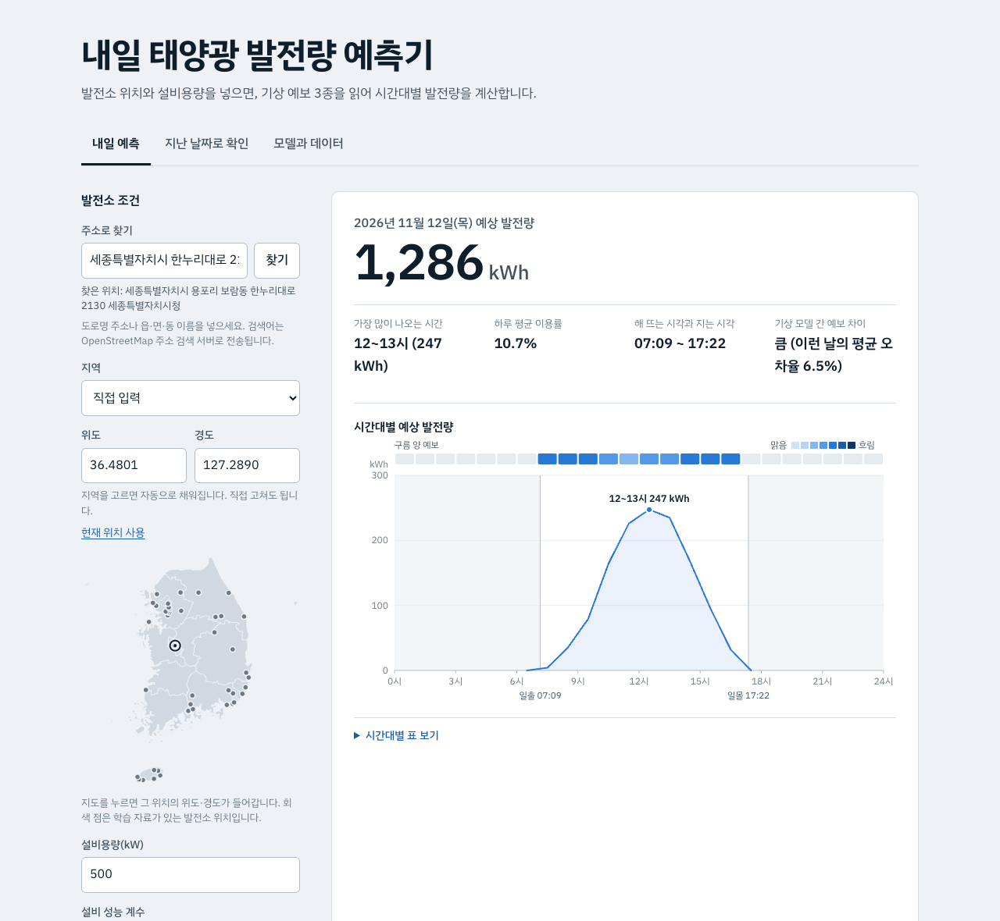

## 0. 프로젝트 정보

| 항목 | 내용 |
|---|---|
| 학번·이름 | 201935607 김대현 |
| 과목 | 가천대학교 기계학습 프로그래밍, 기말 프로젝트 |
| 데모 URL | https://qwertypotter6873.github.io/pv-tomorrow/ |
| GitHub URL | https://github.com/qwertypotter6873/pv-tomorrow |
| 데이터 형태 | 시계열(표 형태): 1시간 단위 발전량 + 기상 예보 |
| 학습 방식 | 처음부터 학습(Scratch) |
| 최종 모델 | 그래디언트 부스팅과 양방향 GRU의 평균 앙상블 |

**핵심 결과** (시험 구간 2025-05-01 ~ 2026-02-28, 학습에 쓰지 않은 기간)

| 지표 | 2일 전 실적(기준) | 선형회귀(베이스라인) | 최종 모델 |
|---|---:|---:|---:|
| 개별 발전소 평균 오차율 NMAE | 12.62% | 7.97% | **6.33%** |
| 발전소 묶음 오차율(이용률 10% 이상 시간대) | 11.63% | 6.74% | **3.82%** |
| R² | 0.27 | 0.75 | **0.82** |

## 1. 문제 정의

**누가 (Who)**
소규모 태양광 발전사업자와, 이들의 발전소를 모아 전력시장에 참여하는 전력중개사업자.

**무엇을 (What)**
발전소 위치와 설비용량만으로 다음 날 0~24시의 시간대별 발전량(kWh)을 예측한다.

**언제 (When)**
발전 하루 전, 다음 날 예측값을 제출하기 전.

**왜 (Why)**
재생에너지 발전량 예측제도는 하루 전에 제출한 예측이 실제와 가까울 때만 정산금을 준다. 20MW를 넘는 자원이 대상이라 소규모 발전소는 중개사업자가 여러 곳을 묶어 참여한다([참여 방법](https://blog.haezoom.com/insight_vpp_19/)). 태양광은 2025년 6월부터 오차율 기준이 8%에서 6%로 강화됐다([정산기준 변경](https://blog.haezoom.com/notice_05)). 태양광은 날씨에 따라 발전량이 크게 달라져서, 전날 실적을 그대로 쓰는 식으로는 이 기준을 맞출 수 없다. 시험 구간에서 2일 전 실적을 그대로 쓰면 오차율이 12.6%였다.

**기존 서비스와 다른 점**

| | 전력중개사업자의 예측 서비스 | 이 프로젝트 |
|---|---|---|
| 이용 조건 | 중개 계약을 맺은 발전소 | 가입 없이 위치와 용량만 입력 |
| 검증 | 사업자가 집계한 오차율을 봄 | 지난 날짜를 골라 예측과 실제를 직접 대조 |
| 재현성 | 방법 비공개 | 데이터·코드·모델 파일 모두 공개 |
| 실행 위치 | 사업자 서버 | 사용자의 브라우저(서버 없음) |

**정량 목표와 결과**

평가 지표는 `|예측 − 실제| ÷ 설비용량`의 평균(NMAE)이다.

| 목표 | 기준 | 시험 결과 | 달성 |
|---|---|---:|---|
| 1. 발전소 묶음 오차율 | 6% 이하 (제도가 정산하는 단위, 이용률 10% 이상 시간대) | 3.82% | 달성 |
| 2. 개별 발전소 평균 오차율 | 6% 이하 (도전 목표) | 6.33% | 미달 |

개별 발전소 30개 중 17개가 6% 이내였다. 육지 발전소 평균은 5.94%, 제주는 7.98%였다.

## 2. 데이터

**출처와 라이선스**

| 구분 | 출처 | 라이선스 | 내용 |
|---|---|---|---|
| 발전실적 | [공공데이터포털](https://www.data.go.kr), 한국남부발전(주) 발전소별 태양광 발전실적 (예: [부산신항](https://www.data.go.kr/data/15043388/fileData.do)) | 이용허락범위 제한 없음 | 발전소·호기별 1시간 단위 발전량 |
| 설비용량 | 공공데이터포털, [한국남부발전(주) 에너지원별 신재생에너지 발전설비 현황](https://www.data.go.kr/data/15003687/fileData.do) | 이용허락범위 제한 없음 | 발전소별 공식 설비용량, 준공 연도 |
| 날씨 예보 | [Open-Meteo Previous Runs API](https://open-meteo.com/en/docs/previous-runs-api) | CC BY 4.0 | 24시간 전에 발표된 예보. 기상 모델 3종(일본 기상청 JMA, 유럽중기예보센터 ECMWF, 독일 기상청 ICON) |

발전소 좌표는 공개 자료에 없어 발전소 이름의 소재지(읍·면·동)로 직접 정리했다(`data/plants.csv`).

**규모**

| 항목 | 값 |
|---|---|
| 발전실적 원자료 | 파일 33개, 일 단위 134,140행(시간 단위 3,219,360건), 2013-01-01 ~ 2026-02-28 |
| 사용 기간 | 2024-03-08 ~ 2026-02-28 (세 기상 모델의 하루 전 예보가 모두 있는 기간) |
| 정제 전 | 발전소·호기 42개, 시간 단위 728,784행 |
| 정제 후 | 발전소·호기 40개(위치 18곳), 낮 시간 343,306행, 입력 특성 40개 |
| 날씨 원자료 | 위치 18곳 × 1시간 단위 18,960행 × 변수 27개 |

**구성**

회귀 문제라 클래스가 없어, 지역·규모의 분포와 목표값의 구간별 분포를 적는다.

| 지역 | 발전소·호기 | 위치 | 설비용량 합계 |
|---|---:|---:|---:|
| 육지(부산, 인천, 하동, 삼척, 영월, 이천, 홍천) | 33 | 11 | 25.6 MW |
| 제주 | 7 | 7 | 5.7 MW |

| 설비용량 | 100kW 이하 | 100~500kW | 500kW~1MW | 1MW 초과 |
|---|---:|---:|---:|---:|
| 발전소·호기 수 | 5 | 9 | 20 | 6 |

**목표값 분포** (분류 문제의 클래스 분포에 해당)

목표값은 설비이용률(발전량 ÷ 설비용량)이고, 낮 시간 기준 평균 0.269, 중앙값 0.204, 최대 0.972다. 구간별 비율은 분할마다 비슷하다.

| 설비이용률 구간 | 10% 미만 | 10~30% | 30~50% | 50% 이상 |
|---|---:|---:|---:|---:|
| 전체 | 34.6% | 25.8% | 18.3% | 21.2% |
| 학습 | 36.0% | 26.2% | 17.9% | 19.8% |
| 검증 | 31.7% | 25.1% | 17.4% | 25.8% |
| 시험 | 35.1% | 26.6% | 18.3% | 20.0% |
| 시험(처음 보는 발전소) | 33.9% | 25.4% | 19.8% | 20.9% |

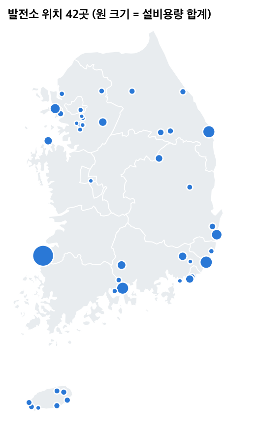

**선정 이유**

- 과제가 권장한 공공데이터포털 자료이고, 이용허락범위 제한이 없어 저장소에 원자료를 함께 올릴 수 있다.
- 발전소 단위로 1시간 간격 실적이 13년 치 있고, 공식 설비용량도 같은 포털에서 구할 수 있다. 예측제도의 오차율이 설비용량 대비 값이라 용량 정보가 꼭 필요하다.
- 육지와 제주, 40kW부터 2.6MW까지 섞여 있어 한 모델이 여러 조건에서 통하는지 볼 수 있다.
- 날씨는 관측값이 아니라 **예보 이력**을 썼다. 서비스 시점에는 예보만 알 수 있으므로, 관측값으로 학습하면 실제보다 좋은 성능이 나온다. Open-Meteo는 "그 시각을 24시간 전에 예보한 값"을 2024년부터 제공한다.

## 3. 데이터 전처리

처리 코드는 `src/build_dataset.py`이고, 단계별 전·후 건수는 `data/processed/prep_report.json`에 남는다.

| 단계 | 기법 | 이유 | 전(행) | 후(행) |
|---|---|---|---:|---:|
| ① | 형식 통일: 넓은 표(하루 한 줄, 시간 열 24개)를 긴 표(한 시간 한 줄)로, 헤더 2종 통일 | 날씨와 시각 단위로 맞붙이기 위해 | 파일 33개 | 728,784 |
| ② | 결측·음수 제거 | 값 오류 | 728,784 | 728,784 |
| ③ | 실적이 공식 설비용량의 105%를 넘는 발전소 제외(2곳) | 용량 정보가 틀리면 오차율이 모두 틀어짐 | 728,784 | 694,080 |
| ④ | 정지일 제외: 하루 발전량이 평소 중앙값의 2% 미만인 날(403건) | 고장·정비는 날씨로 설명되지 않음 | 694,080 | 684,408 |
| ⑤ | 날씨 결합, 파생 변수 생성 | 아래 설명 | 684,408 | 684,369 |
| ⑥ | 밤 시간(태양 고도 0° 이하) 제외 | 발전량이 0으로 정해져 있음 | 684,369 | 343,306 |
| ⑧ | 정규화: 발전량 ÷ 설비용량 | 규모가 다른 발전소를 한 모델로 학습 | | |

**파생 변수** (모두 서비스 시점에도 계산할 수 있는 값)

- 태양 위치: 태양 고도의 사인값, 방위각, 대기권 밖 일사량(`src/solar.py`, NOAA 간이식)
- 맑음 지수: 예보 일사량 ÷ 대기권 밖 일사량
- 기상 모델 3종의 일사량 평균·표준편차·최소·최대, 구름 양 평균
- 계절: 연중 일수의 사인·코사인

**전·후 비교**

| 항목 | 전 | 후 |
|---|---|---|
| 표 형태 | 33개 파일, 하루 한 줄, 헤더 2종 | 표 1개, 한 시간 한 줄 |
| 발전량이 0인 행의 비율 | 50.2% | 3.6% |
| 발전소 간 최대 출력 차이 | 94배 (23 ~ 2,139 kW) | 2.9배 (설비이용률 0.30 ~ 0.88) |
| 모델 입력 특성 | 없음 | 40개 |
| 실제 발전량과의 상관계수 | 기상 모델 1종 일사량 0.80 ~ 0.81 | 3종 평균 일사량 0.83 |

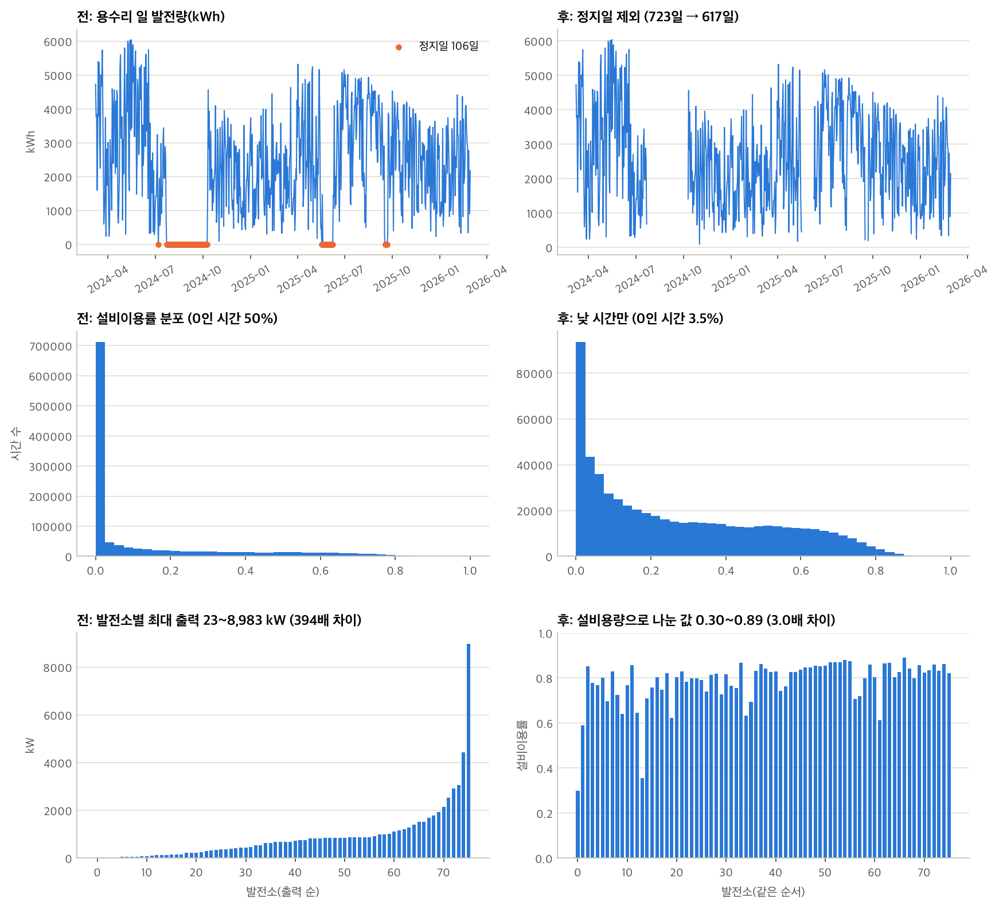

**분할** (seed 42)

시간 순서로 나눴다. 무작위로 섞으면 미래 날씨가 학습에 들어가기 때문이다.

| 구분 | 기간 | 행 | 비율 |
|---|---|---:|---:|
| 학습 | 2024-03-08 ~ 2024-12-31 | 109,116 | 42.5% |
| 검증 | 2025-01-01 ~ 2025-04-30 | 40,306 | 15.7% |
| 시험 | 2025-05-01 ~ 2026-02-28 | 107,584 | 41.9% |
| 시험(처음 보는 발전소) | 2025-05-01 ~ 2026-02-28 | 36,221 | 별도 |

- 처음 보는 발전소: 위치 4곳(홍천 화촌, 하동본부, 이천 백사면, 제주 와산리, 발전소·호기 10개)을 seed 42로 뽑아 학습·검증에서 통째로 뺐다. 서비스는 학습에 없던 위치도 입력받으므로 이 경우의 성능을 따로 잰다.
- 모델과 설정은 검증 구간으로만 골랐다. 고른 뒤에는 학습+검증으로 다시 학습해 시험 구간을 한 번 평가했다.

## 4. 모델

모든 모델을 처음부터 학습했다(Scratch). 목표값은 `발전량 ÷ 유효 용량`이다. 유효 용량은 발전소별로 학습 기간의 시간당 발전량 99.5백분위다. 공식 설비용량 대비 실제 최대 출력이 발전소마다 32~86%로 달랐기 때문에, 날씨에 따른 출력 비율과 발전소별 규모를 나눠서 다뤘다.

| 구분 | 모델 | 입력 | 선정 이유 |
|---|---|---|---|
| 기준 | 2일 전 같은 시각 실적 | 없음(학습 없음) | 예측 모델이 없을 때의 방법. 하루 전 오전에는 전날 실적이 다 나오지 않아 2일 전을 쓴다 |
| 베이스라인 | 선형회귀 | 예보 일사량 3종 평균 1개 | 발전량이 일사량에 비례한다는 물리 관계만 쓴 가장 단순한 학습 모델 |
| 제안 1 | 그래디언트 부스팅 (scikit-learn `HistGradientBoostingRegressor`) | 특성 40개 | 표 형태 자료에 강하고, 태양 고도·구름·일사량의 비선형 관계와 상호작용을 스스로 찾는다 |
| 제안 2 | 양방향 GRU (PyTorch, 은닉 64, 2층, 파라미터 135,361개) | 하루 24시간 순서열 × 특성 40개 | 앞뒤 시간대의 예보 흐름을 함께 본다. 수업의 순환 신경망을 시계열 회귀에 적용 |
| 최종 | 제안 1과 제안 2의 평균 | | 검증 오차가 가장 낮았다 |

**학습 설정**

- 손실: 절대 오차(평가 지표와 같음). GRU는 설비용량 대비 절대 오차를 낮 시간에만 계산한다.
- 그래디언트 부스팅: 설정 3가지를 800트리까지 학습하고, 트리를 하나 더할 때마다 검증 오차를 재서 트리 수를 골랐다. 선택: 잎 127개, 학습률 0.04, 트리 254개.
- GRU: AdamW, 학습률 최대 0.002(OneCycle), 배치 128. 은닉 크기와 epoch 수를 바꾼 설정 3가지 중 은닉 64, 12 epoch을 골랐다.

**학습 로그 요약** (전체 로그는 노트북 4절. 학습 시간은 800트리·전체 epoch 기준이고 실행할 때마다 조금씩 다르다)

| 모델 | 설정 | 검증 NMAE | 학습 시간 |
|---|---|---:|---:|
| 그래디언트 부스팅 | A: 잎 31 | 7.580% (트리 574개) | 19초 |
| | B: 잎 63 | 7.551% (트리 174개) | 29초 |
| | **C: 잎 127** | **7.542% (트리 254개)** | 50초 |
| GRU | **은닉 64, 12 epoch** | **7.505%** | 29초 |
| | 은닉 64, 40 epoch | 7.824% | 98초 |
| | 은닉 128, 12 epoch | 7.560% | 55초 |

**검증 구간 비교와 최종 선택**

| 모델 | 검증 NMAE | 검증 RMSE | R² |
|---|---:|---:|---:|
| 기준: 2일 전 실적 | 13.48% | 21.62% | 0.29 |
| 베이스라인: 선형회귀 | 9.75% | 14.50% | 0.68 |
| 제안 1: 그래디언트 부스팅 | 7.54% | 12.59% | 0.76 |
| 제안 2: GRU | 7.51% | 12.88% | 0.75 |
| **제안 1+2: 평균 앙상블** | **7.42%** | 12.63% | 0.76 |

## 5. 평가 결과

**시험 구간 비교표** (기존 발전소 30개, 낮 시간 107,584건)

| 모델 | NMAE | RMSE | R² | 이용률 10% 이상 시간대 NMAE | 묶음 NMAE | 묶음 NMAE(이용률 10% 이상) | 묶음 오차 6% 이내 시간 비율 |
|---|---:|---:|---:|---:|---:|---:|---:|
| 기준: 2일 전 실적 | 12.62% | 19.78% | 0.27 | 15.19% | 9.42% | 11.63% | 40.3% |
| 베이스라인: 선형회귀 | 7.97% | 11.55% | 0.75 | 9.98% | 5.25% | 6.74% | 58.1% |
| 제안 1: 그래디언트 부스팅 | 6.45% | 9.96% | 0.81 | 8.12% | 2.98% | 3.88% | 78.5% |
| 제안 2: GRU | 6.39% | 9.98% | 0.81 | 8.03% | 3.02% | 3.93% | 78.1% |
| **제안 1+2: 평균 앙상블 (최종)** | **6.33%** | **9.85%** | **0.82** | **7.96%** | **2.93%** | **3.82%** | **78.5%** |

- NMAE, RMSE는 설비용량 대비 값이다. 묶음은 발전소 30개의 예측과 실제를 시각별로 합쳐서 계산했다.
- 기준 예측은 2일 전 자료가 있는 98.9%의 행으로 계산했다.

**처음 보는 발전소** (위치 4곳, 발전소·호기 10개, 36,221건)

| 모델 | NMAE | RMSE | R² | 묶음 NMAE |
|---|---:|---:|---:|---:|
| 기준: 2일 전 실적 | 13.10% | 20.41% | 0.23 | 10.48% |
| 베이스라인: 선형회귀 | 9.85% | 13.58% | 0.66 | 5.81% |
| 최종: 평균 앙상블 | 8.49% | 12.50% | 0.71 | 4.12% |

**최종 모델 근거**

- 검증 구간에서 평균 앙상블의 NMAE가 가장 낮아 최종 모델로 정했다(시험 결과를 보고 고르지 않았다).
- 시험 구간에서도 순위가 같았다. 베이스라인 대비 NMAE가 21% 줄었고, 기준 예측 대비 50% 줄었다.
- 부스팅과 GRU는 단독 성능이 거의 같은데(6.45%, 6.39%) 평균하면 6.33%로 더 낮아진다. 두 모델이 서로 다른 곳에서 틀린다는 뜻이다.

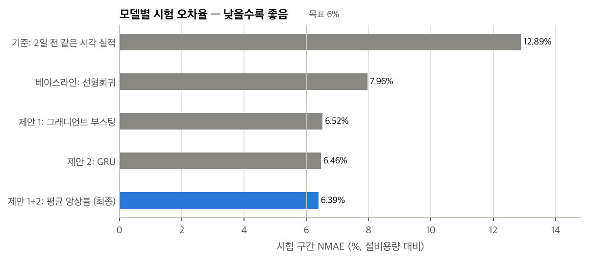

**학습 곡선**

부스팅은 트리 150개 근처부터 검증 오차가 더 줄지 않는다. 학습 오차와 검증 오차의 차이(2.7%p)에는 과적합 외에 계절 차이도 섞여 있다. 학습 구간(3~12월)에는 없는 1~2월이 검증 구간에 들어 있기 때문이다.

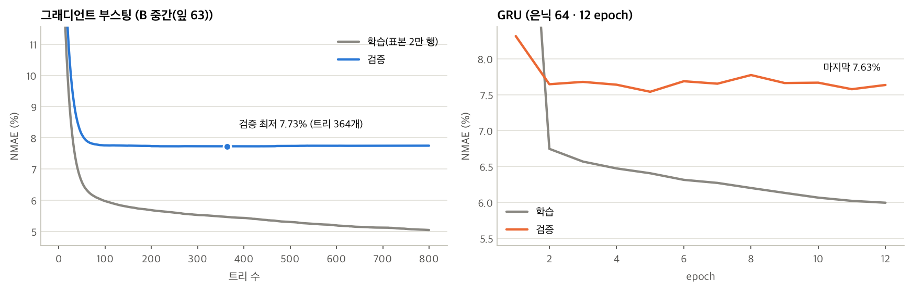

**오류 분석**

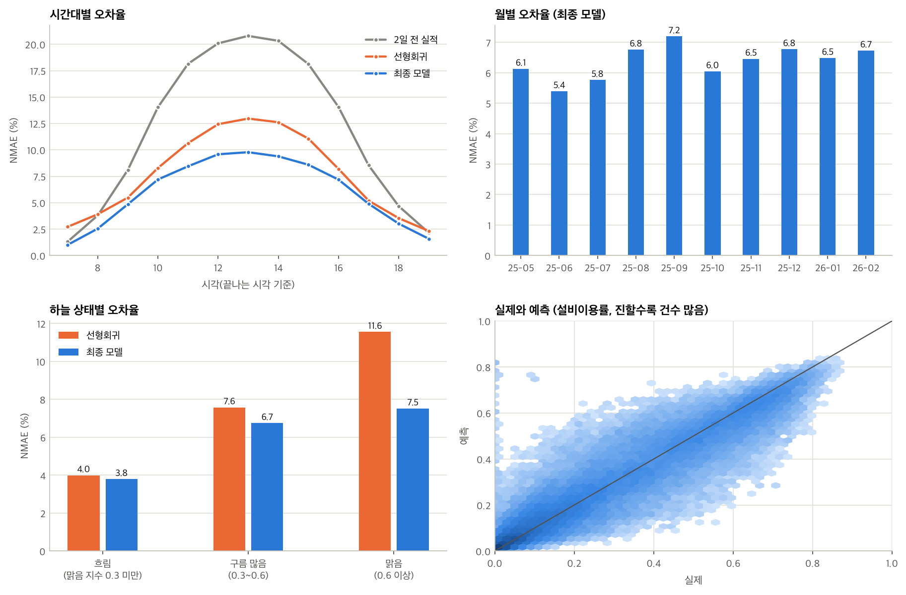

- 시간대: 오차는 발전량이 많은 한낮(12~14시)에 가장 크다. 최종 모델은 한낮 오차를 선형회귀의 13%에서 10%로 줄였다.
- 하늘 상태: 흐린 날은 선형회귀와 차이가 작고(4.0% 대 3.8%), 맑은 날에 차이가 가장 크다(11.6% 대 7.5%). 맑은 날의 출력은 발전소 상태와 태양 고도에 따라 달라지는데 선형회귀는 이를 반영하지 못한다.
- 월별: 5.4%(6월) ~ 7.2%(9월)로, 특정 계절에 무너지지 않는다.

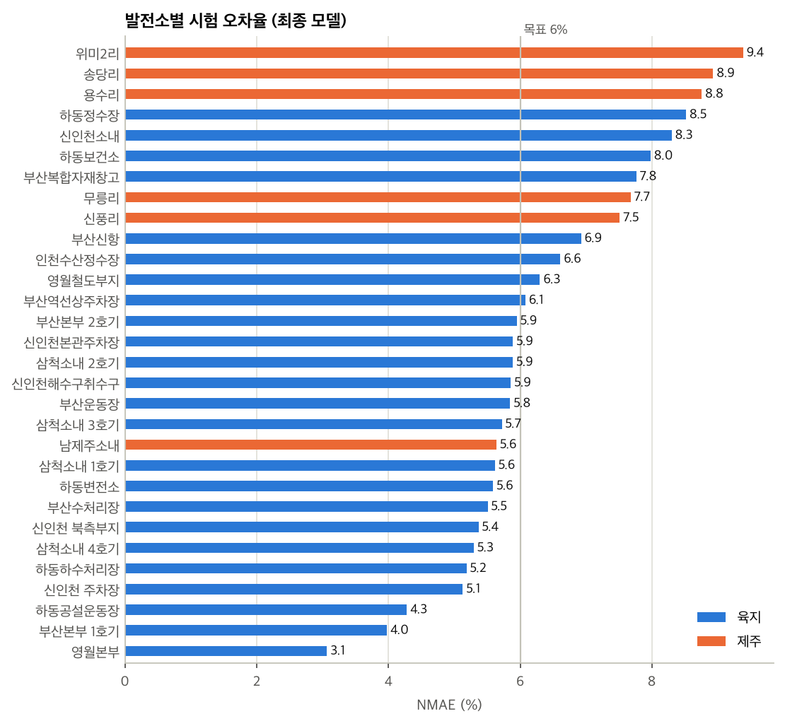

- 발전소별: 3.1% ~ 9.4%. 제주 발전소(평균 7.98%)가 육지(5.94%)보다 높다.
- 맑은 한낮인데 출력이 15% 미만인 시간의 비율이 제주 5.21%, 육지 0.78%였다. 날씨로 설명되지 않는 출력 감소가 제주에서 6.7배 많다는 뜻이고, 예보만 보는 모델은 이를 맞출 수 없다.

**하루 발전량 등급 혼동행렬과 오류 사례**

하루 발전량을 적음·보통·많음으로 나눠 예측 등급과 실제 등급을 비교했다(경계는 학습 구간의 3분위).

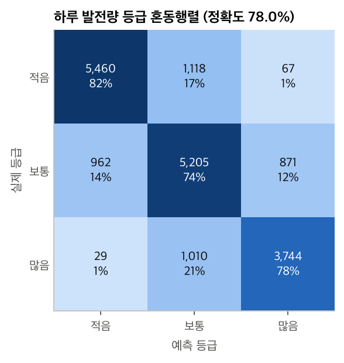

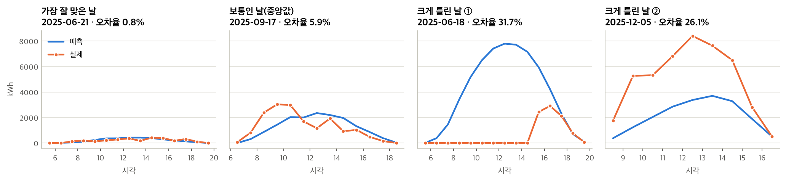

크게 틀린 날 ①은 한낮 4시간 동안 실제 발전량이 0이었다(부분 정지). 정지일 제외 규칙은 하루 전체가 멈춘 날만 걸러서 이런 날이 남는다.

**추가 실험** (검증 구간, 같은 부스팅 설정)

| 입력 | 특성 수 | 검증 NMAE |
|---|---:|---:|
| JMA 48시간 전 예보(변수 5개) | 11 | 9.53% |
| JMA 24시간 전 예보(변수 5개) | 11 | 8.44% |
| JMA 24시간 전 예보(전체 변수) | 15 | 8.38% |
| 기상 모델 3종 24시간 전 예보(전체 특성) | 40 | 7.58% |

예보가 하루 더 이르면 오차가 1.1%p 늘고, 기상 모델을 1종에서 3종으로 늘리면 0.8%p 준다.

## 6. 서비스 프로토타입

**모델 연동 방식**

1. 노트북이 학습한 모델을 ONNX 파일로 내보낸다: `web/model/pv_gbm.onnx`(트리 254개, 2.1MB), `web/model/pv_gru.onnx`(0.5MB).
2. 웹 페이지가 이 두 파일을 내려받아 [onnxruntime-web](https://onnxruntime.ai/)으로 **브라우저 안에서** 추론한다. 추론 서버도, 외부 AI API 호출도 없다.
3. 입력 특성은 브라우저가 직접 만든다. Open-Meteo에서 내일 예보를 받고(`web/js/forecast.js`), 태양 위치를 계산해(`web/js/solar.js`) 학습 때와 같은 40개 특성으로 조립한다(`web/js/features.js`).
4. 두 모델 출력의 평균에 설비용량과 성능 계수를 곱해 kWh로 바꾼다.

학습 코드(파이썬)와 서비스 코드(자바스크립트)가 같은 값을 내는지 `tests/parity.mjs`로 확인한다. 표본 4일에서 특성의 최대 상대오차는 0.000005, 예측 차이는 설비용량의 0.04% 이하였다.

**화면**

| 내일 예측 | 지난 날짜로 확인 |
|---|---|
|  | 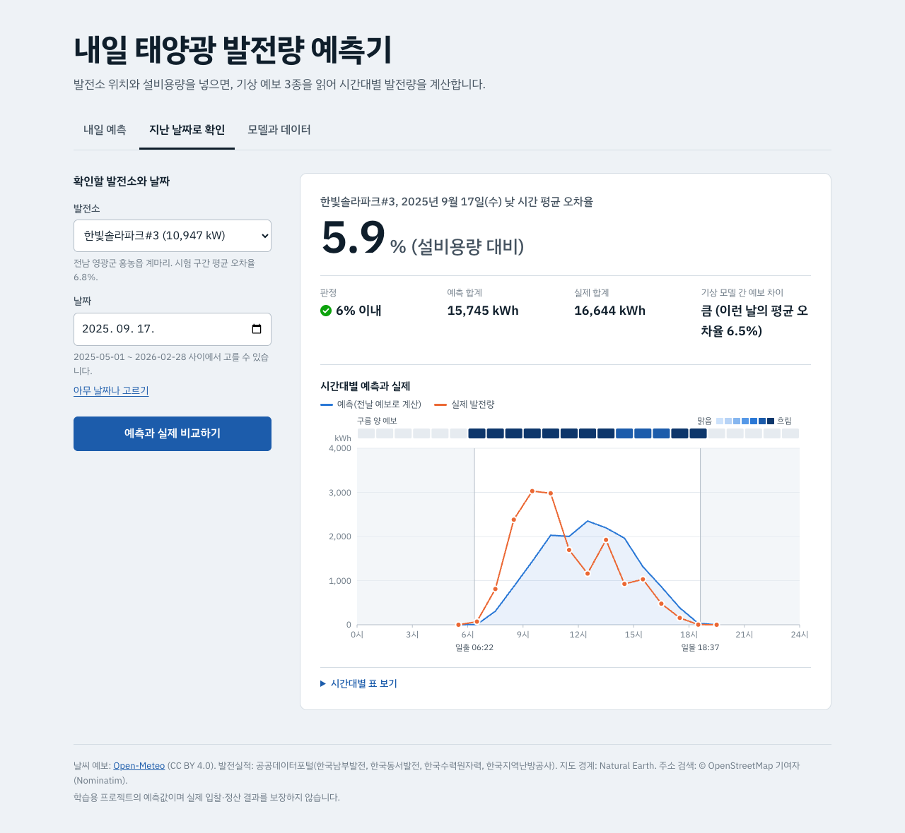 |

| 잘못된 입력 안내 | 모델과 데이터 |
|---|---|
| 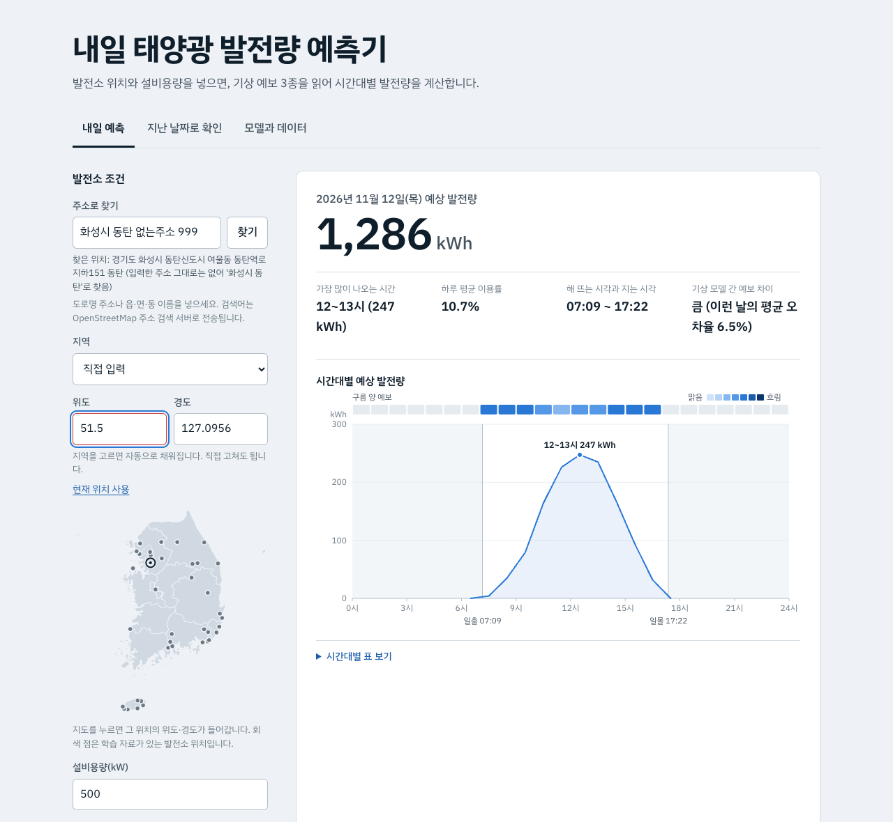 | 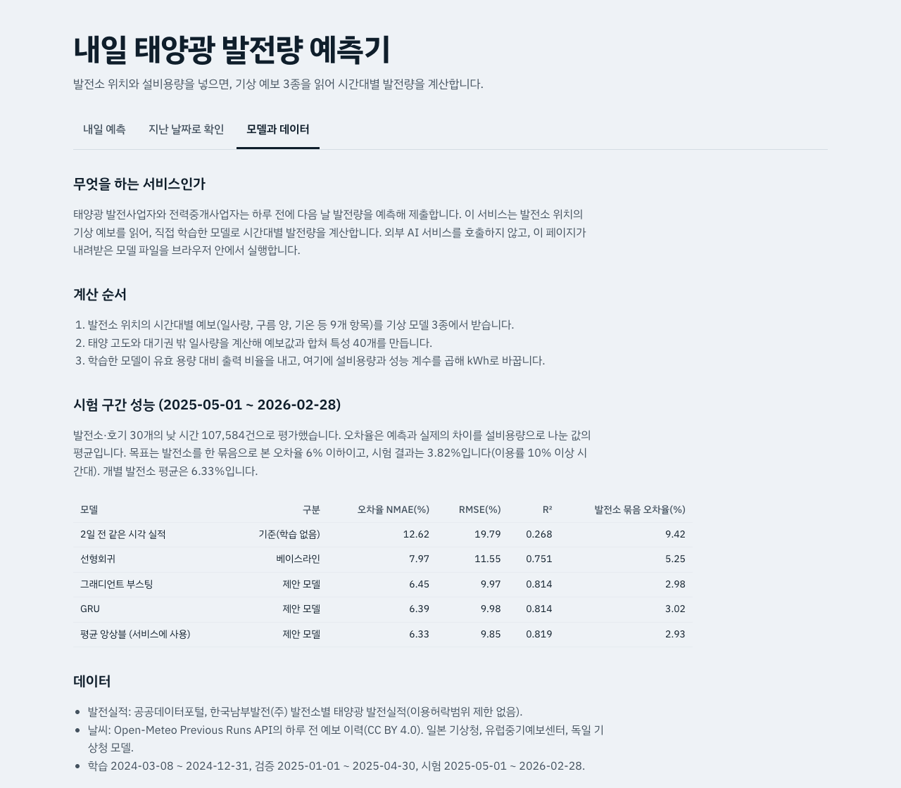 |

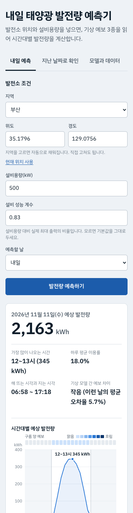

**사용 안내**

- 내일 예측: 지역을 고르거나 위도·경도를 넣고, 설비용량(kW)을 입력한 뒤 `발전량 예측하기`를 누른다. 하루 합계, 가장 많이 나오는 시간, 시간대별 곡선과 구름 양 예보가 나온다. 표는 CSV로 저장할 수 있다.
- 설비 성능 계수: 설비용량 대비 실제 최대 출력의 비율. 기본값 0.83은 학습 발전소들의 중앙값이다.
- 지난 날짜로 확인: 발전소와 시험 구간의 날짜를 고르면, 그 전날 발표된 예보로 계산한 예측과 실제 발전량을 겹쳐 보여 주고 그날의 오차율을 계산한다. 학습에 쓰지 않은 발전소도 고를 수 있다.
- 차트 위에 마우스를 올리거나, 차트를 선택한 뒤 좌우 화살표 키를 누르면 시간대별 값이 나온다.

**예외 처리**

| 상황 | 동작 |
|---|---|
| 위도·경도가 대한민국 범위(33~39°, 124~132°) 밖 | 입력란을 표시하고 허용 범위와 입력한 값을 안내 |
| 설비용량이 비었거나 숫자가 아님 | 무엇을 입력해야 하는지 안내 |
| 시험 구간 밖의 날짜, 정지일로 제외된 날 | 고를 수 있는 기간 또는 다른 날짜를 고르라고 안내 |
| 날씨 서버 연결 실패, 요청 한도 초과 | 원인과 다시 시도하는 방법 안내. 이전 결과는 화면에 남긴다 |
| 일부 기상 모델의 예보값이 비어 있음 | 나머지 모델의 평균으로 채우고 몇 칸을 채웠는지 표시 |

## 7. 배포

| 항목 | 내용 |
|---|---|
| 플랫폼 | GitHub Pages. GitHub Actions가 `web/` 폴더를 배포한다(`.github/workflows/pages.yml`) |
| 공개 URL | https://qwertypotter6873.github.io/pv-tomorrow/ |
| 배포 대상 | `web/` 폴더(정적 파일 + 모델 파일). 빌드 과정 없음 |
| 서버 | 없음. 추론은 브라우저에서, 날씨는 Open-Meteo 공개 API에서 직접 받음 |

API 키를 쓰지 않아 저장소에 비밀값이 없다.

## 8. 실행 방법

**실행 환경**: Python 3.13, macOS(Apple M1 Pro)에서 확인. GPU 불필요. 전체 실행 약 7분.

```bash
git clone https://github.com/qwertypotter6873/pv-tomorrow.git
cd pv-tomorrow
python -m venv .venv && source .venv/bin/activate      # Windows: .venv\Scripts\activate
pip install -r requirements.txt

# 1) 학습·평가 노트북 실행 (원자료가 저장소에 있어 내려받기 없이 실행됨)
jupyter nbconvert --to notebook --execute --inplace notebooks/pv_tomorrow.ipynb

# 2) 웹 서비스를 내 컴퓨터에서 열기 → http://localhost:8765
python -m http.server 8765 --directory web

# 3) (선택) 학습 코드와 웹 코드의 계산 일치 확인 — Node.js 필요
cd tests && npm install && node parity.mjs
```

**가중치 위치**

| 파일 | 내용 |
|---|---|
| `web/model/pv_gbm.onnx` | 그래디언트 부스팅(트리 254개) |
| `web/model/pv_gru.onnx` | 양방향 GRU |
| `web/model/meta.json` | 특성 순서, GRU 입력 표준화 값, 기본 성능 계수, 시험 성능 |

**폴더 구성**

```
data/plants.csv          발전소 목록(좌표, 공식 설비용량, 제외 사유)
data/raw/                원자료(발전실적 CSV, 날씨 예보 이력)
src/download_*.py        원자료 내려받기
src/build_dataset.py     전처리·분할
src/modeling.py          평가 지표, GRU 모델과 학습 루프
src/export_onnx.py       부스팅 모델 → ONNX 변환기
notebooks/pv_tomorrow.ipynb   학습·평가 전 과정(출력 포함)
web/                     서비스(정적 사이트, 모델 파일 포함)
tests/parity.mjs         파이썬·자바스크립트 계산 일치 검증
docs/                    그림, 화면 캡처, 성능표
```

## 9. Lessons Learned

### PMI

**Plus (잘된 점)**

1. 기상 모델 3종의 예보를 함께 넣은 것이 가장 큰 개선이었다. 같은 부스팅 설정에서 JMA 1종만 쓰면 검증 오차가 8.38%, 3종을 쓰면 7.58%였다. 모델 구조를 바꾸는 것보다 입력을 늘리는 쪽의 효과가 컸다.
2. 학습과 서비스의 계산이 같은지 숫자로 확인했다. 태양 위치와 특성 계산을 파이썬과 자바스크립트로 두 번 구현했기 때문에, 표본 4일을 양쪽에서 계산해 비교하는 검증 스크립트를 만들었다. 특성의 최대 상대오차가 0.000005였다.
3. 시험 구간을 한 번만 쓰는 절차를 지켰고, 학습에 없던 위치 4곳을 따로 떼어 평가했다. 그래서 "처음 보는 발전소에서는 오차가 8.49%로 늘어난다"는 한계를 수치로 말할 수 있다.

**Minus (아쉬운 점)**

1. 개별 발전소 목표 6%를 달성하지 못했다(6.33%). 발전소 30개 중 13개가 6%를 넘었고, 제주 발전소는 평균 7.98%였다.
2. 하루 전 예보 이력이 2024년 3월부터만 있어 전체 기간이 24개월뿐이었다. 학습 구간에 1~2월이 없어서 검증 구간과 계절이 어긋났고, 학습과 검증 오차의 차이(2.7%p) 중 얼마가 과적합이고 얼마가 계절 차이인지 가를 수 없었다.
3. 발전소 좌표를 읍·면·동 수준의 근사값으로 넣었다. 소재지를 특정하지 못한 발전소 3곳은 쓰지 못했고, 패널의 방향과 기울기 정보는 아예 없었다.

**Interesting (흥미로운 점)**

1. 구조가 전혀 다른 부스팅과 GRU의 시험 오차가 6.45%와 6.39%로 거의 같았고, 둘을 평균하면 6.33%로 더 낮아졌다. 입력이 같으면 모델 종류보다 입력의 정보량이 성능을 정한다는 것을 봤다.
2. 기상 모델끼리 예보가 가장 크게 엇갈리는 날의 오차(6.39%)가 중간인 날(7.01%)보다 낮았다. 엇갈림이 큰 날은 대부분 흐린 날(맑음 지수 0.30)이라 발전량 자체가 작고, 그래서 설비용량 대비 오차도 작았다. 예보가 엇갈리면 더 틀릴 것이라는 예상과 달랐다.
3. 공식 설비용량 대비 실제 최대 출력이 발전소마다 32~86%였다. 2008년에 준공한 부산본부 1호기는 설비용량의 3분의 1 정도만 낸다. 설비용량만으로는 발전소의 규모를 알 수 없었다.

### 문제 해결 사례

**사례 1. 모델을 브라우저용 파일로 바꾸는 변환기가 실패함**

- 문제: 학습한 부스팅 모델을 ONNX로 바꾸는 `skl2onnx`가 `Expected an int, got a boolean` 오류로 멈췄다. 이 파일이 없으면 서버 없이 브라우저에서 추론한다는 설계가 성립하지 않는다.
- 원인: 변환기가 트리의 "결측값이 왼쪽으로 가는가" 값을 불리언 그대로 넘기는데, 설치된 onnx는 정수만 받았다. 라이브러리 버전 조합의 문제였다.
- 시도: 버전을 낮추는 대신, 학습된 트리 구조(분기 특성, 임계값, 자식 노드, 잎 값)를 직접 읽어 ONNX의 `TreeEnsembleRegressor` 노드를 만드는 변환기를 작성했다(`src/export_onnx.py`, 약 60줄).
- 결과: 시험 자료 107,584행에서 원래 모델과의 최대 차이가 0.00000023이었고, 브라우저용 런타임에서도 같은 값이 나왔다.

**사례 2. GRU의 검증 오차가 학습할수록 나빠짐**

- 문제: GRU를 40 epoch 학습하면 학습 오차는 4.9%까지 내려가는데 검증 오차는 10 epoch 부근 7.55%에서 7.82%로 올라갔다.
- 원인: 하루 단위 표본이 8,791개뿐이라 파라미터 13만 개짜리 모델이 학습 자료를 외웠다.
- 시도: 조기 종료를 쓰면 학습+검증으로 다시 학습할 때 멈출 시점을 정할 수 없다. 그래서 epoch 수를 설정값으로 두고(12, 40), 학습률 일정을 그 길이에 맞춘 뒤 검증으로 골랐다.
- 결과: 12 epoch 설정의 검증 오차가 7.50%로 가장 낮았고, 같은 일정으로 다시 학습한 모델의 시험 오차는 6.39%였다.

**사례 3. 날씨 자료의 빈 구간**

- 문제: 처음 받은 날씨 자료에서 층별 구름 양(하층·중층·상층)이 전 기간 비어 있었고, ECMWF 일사량은 2024년 3월 7일 이전이 비어 있었다.
- 원인: Previous Runs API는 변수와 기상 모델마다 제공 시작일이 다르다. 문서에는 변수 목록만 있고 변수별 시작일이 없었다.
- 시도: 한 위치로 먼저 받아 변수별 첫 유효 시각과 결측률을 출력해 확인했다. 층별 구름 양은 요청에서 빼고, 자료 시작일을 세 모델이 모두 있는 2024-03-08로 정했다.
- 결과: 날씨 결측으로 버린 행이 39건(0.006%)으로 줄었고, 요청량도 4분의 1 줄었다.

### 향후 개선 계획

**데이터**

1. 발전소별 최근 실적으로 성능 계수를 자동으로 맞춘다. 처음 보는 발전소의 오차(8.49%)가 기존 발전소(6.33%)보다 큰 가장 큰 이유가 유효 용량을 모르는 것이다.
2. 제주 출력제어 이력을 구해 해당 시간을 학습과 평가에서 구분한다. 맑은 한낮의 출력 감소가 제주에서 6.7배 많았다.
3. 예보 이력이 쌓이는 대로 학습 기간을 늘려, 학습 구간에 사계절이 두 번 이상 들어가게 한다.

**모델**

1. 분위수 손실로 예측 구간(예: 10~90%)을 함께 낸다. 사업자에게는 예측값 하나보다 벗어날 범위가 더 쓸모 있다.
2. 한낮에 몇 시간만 멈춘 부분 정지를 걸러 내는 규칙을 전처리에 추가한다.
3. 한국 기상청 모델(KMA) 예보를 네 번째 입력으로 더한다. 이력이 2025년 3월부터라 이번에는 쓰지 못했다.

**서비스**

1. 여러 발전소를 한꺼번에 입력해 묶음 단위 예측과 오차율을 보여 준다. 제도가 묶음 단위로 정산하기 때문이다.
2. 사용자가 올린 과거 발전량 파일로 그 발전소의 지난 예측 정확도를 계산해 보여 준다.
3. 예측 시각에 맞는 예보를 쓴다. 지금은 24시간 전 예보로 학습했는데, 실제 제출 시각에 따라 예보가 더 이르거나 늦다.
